

<b>العربية</b> · <a href="#english">English</a>

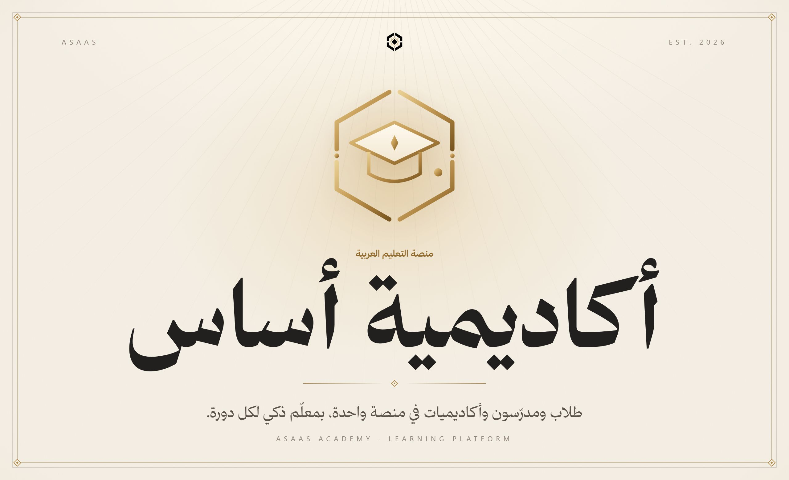

 

منصة تعليمية تجمع الطلاب والمدرّسين والأكاديميات: دورات وفصول دراسية، وواجبات بتصحيح آلي، ومحفظة داخلية بتقسيم إيرادات ثلاثي، وتفاوض على النسب، ومعلّم ذكي لكل دورة. والفيديو فيها محمي ومقروء بنصوص وترجمات، والتعلّم فيها يُحفظ بمراجعة متباعدة ويُكافأ بأوسمة وشهادات. الواجهة عربية أولًا مع نسخة إنجليزية.

 

<b>الكود في مستودع خاص</b> هذه واجهة العرض العامة لـ«أكاديمية أساس». الكود المصدري محفوظ في مستودع خاص، والمساهمة فيه متاحة بدعوة. <a href="https://alaadin-alynaey.site/">تواصل لطلب الوصول أو المساهمة</a>

 

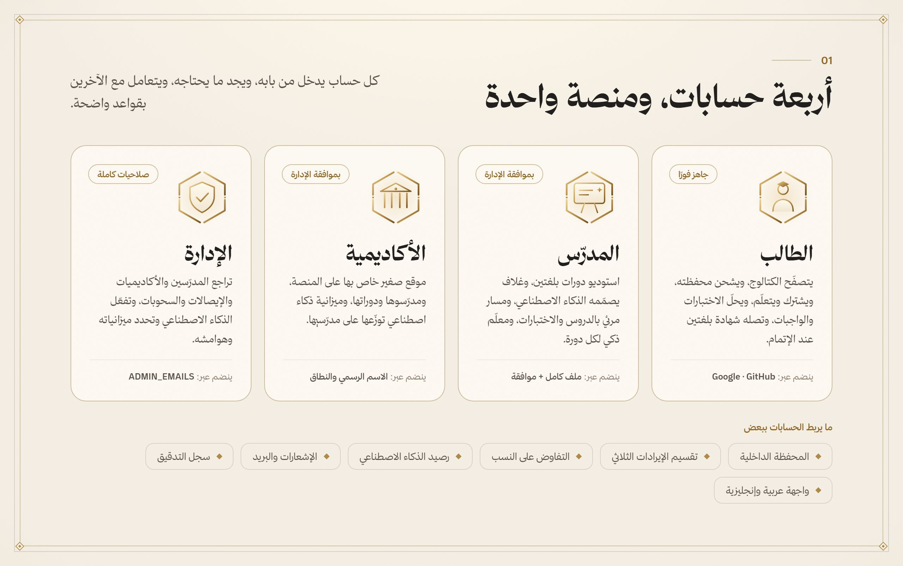

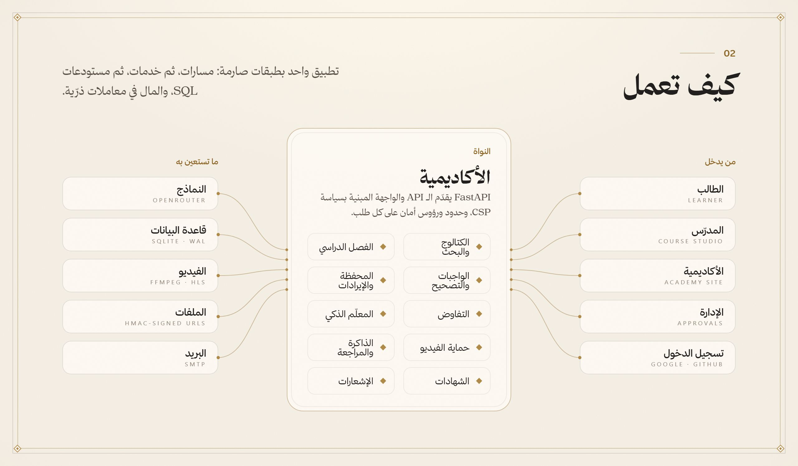

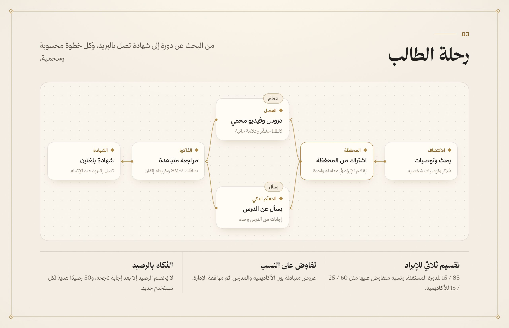

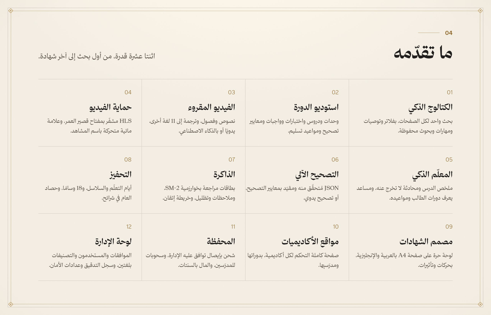

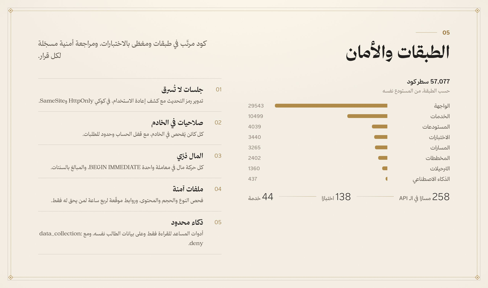

<a href="#arabic">العربية</a> · <b>English</b>

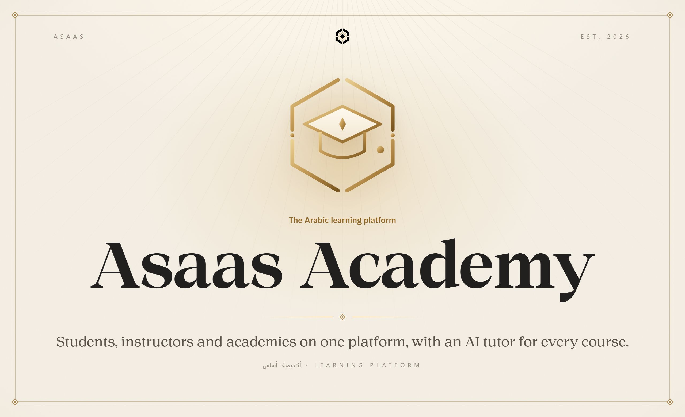

 

A learning platform for students, instructors and academies: courses and classrooms, auto-graded assignments, an internal wallet with a three-way revenue split, negotiated shares, and an AI tutor for every course. Its video is protected and readable with transcripts and captions, and learning sticks through spaced review and is rewarded with medals and certificates. Arabic first, with an English version.

 

<b>The source lives in a private repository</b> This is the public showcase of Asaas Academy. The source code is kept private, and contributions are open by invitation. <a href="https://alaadin-alynaey.site/">Get in touch for access or to contribute</a>

 

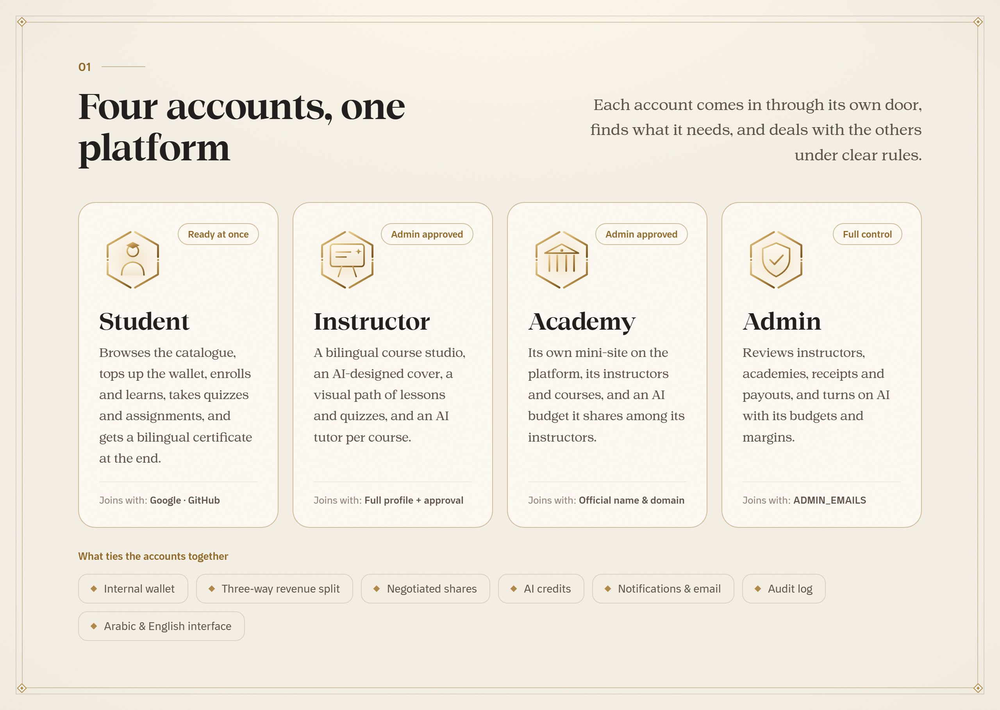

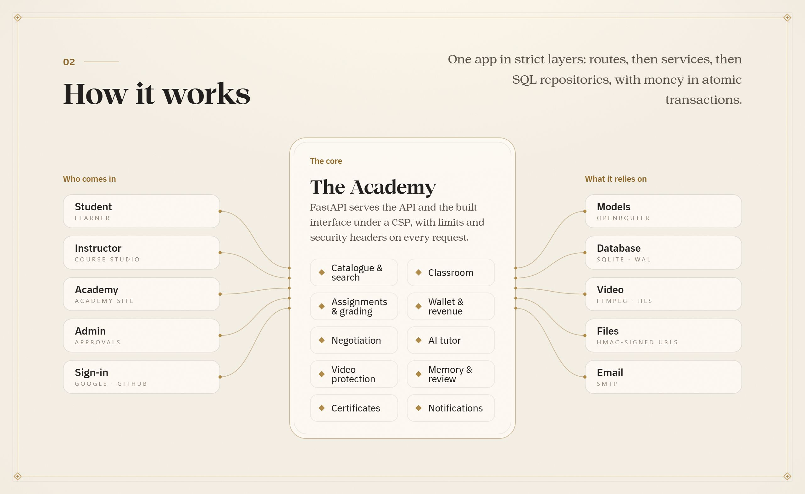

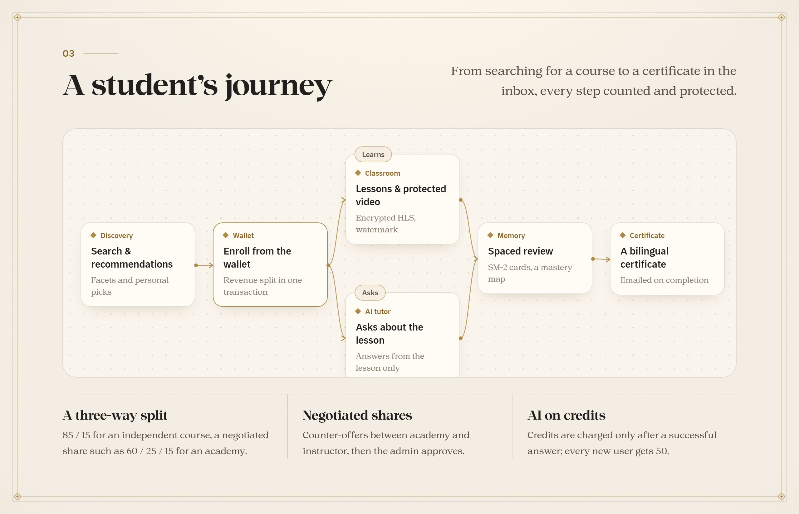

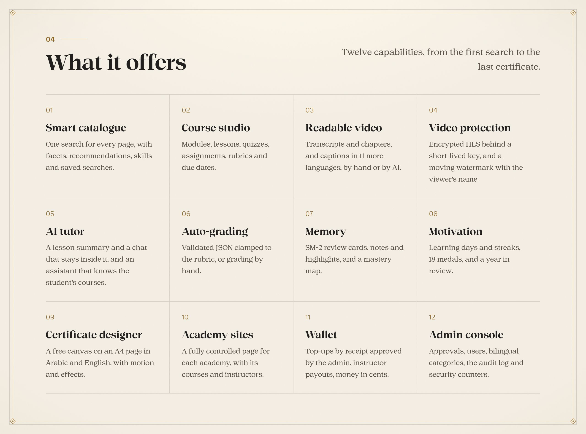

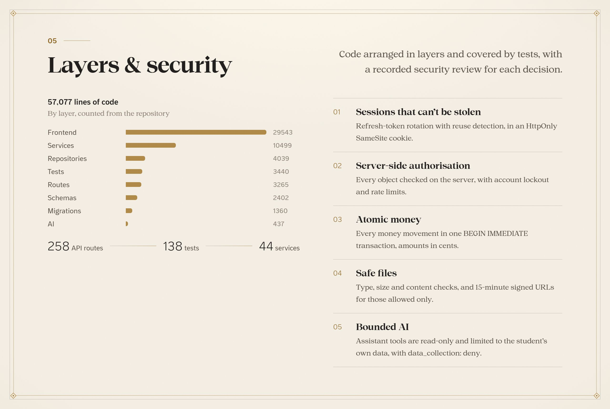

  جزء من منظومة <b>أساس</b> · Part of the <b>Asaas</b> ecosystem
   
  من تصميم وبناء <a href="https://github.com/AladdinAlynaey">علاء الدين اليناعي</a> · Designed and built by <a href="https://github.com/AladdinAlynaey">Alaadin Alynaey</a>
   
  © 2026 · جميع الحقوق محفوظة · All rights reserved

